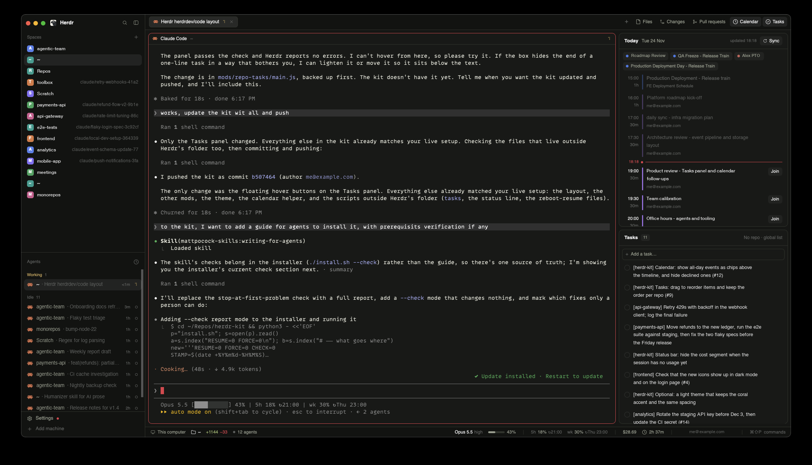

# herdr-kit

My Herdr desktop app setup, for any Mac.



## What you get

- **The `main-md` layout.** It has a sidebar, a tab bar with Files, Changes, Tasks and Pull requests buttons, and a bottom status bar.
- **The `luc` theme.** It uses the colors of luc.sh: olive-black background, warm off-white text, coral accent.
- **Files panel.** It has a search box. Code opens in a syntax-highlighted pane and markdown opens in a preview pane.
- **Tasks panel.** Each repo gets one to-do list, shared by all of its worktrees. Agents add to the same list with `tasks add "[<branch>] <text>"`. The `tasks` command is zamarrowski/herdr-tasks' CLI, pinned in `kit.env`.
- **Status bar.** It shows the focused Claude session's model, effort, context, 5-hour and weekly usage, cost, run time and account. It also shows the folder, the branch with its count of changed files, and the lines added and removed.
- **Working agents** show a braille spinner.
- **Agent banners.** When an agent needs you, or finishes while you're looking elsewhere, you get a macOS banner from `HerdrNotify.app` instead of Herdr's in-app note. Clicking it brings Herdr forward on that agent. Until Herdr Notify is allowed to post, these alerts stay in-app. Other in-app notes are unchanged.
- **Pull requests panel.** It's a tab next to Files and Changes, with two lists. **Waiting on you** shows what needs you now: PRs that ask you for a review by name, your PRs whose CI finished failing, and your PRs that are ready to merge. Each one leaves the list once it's dealt with. **Agents** lists the PRs your agents opened. Click a PR in either list to see its CI, logs and comments. It's based on jjangsky/herdr-pr-flow 0.6.0 (MIT), and no longer follows its releases.
- **GitHub banners.** A macOS banner, from a small helper app called `HerdrNotify.app`, fires when someone asks you for a review by name, when CI finishes failing on one of your PRs, when one of your PRs becomes ready to merge, and when one is merged. Click a banner to open the PR. Herdr checks GitHub once a minute while it's open. After a gap (lid closed, Herdr quit) or a burst of more than 3 events, you get one summary banner instead.
- **Calendar panel.** It shows today's macOS Calendar events with a now line and Join buttons for video calls. **Sync** forces your accounts to refresh (it has Calendar.app reload them, opening it hidden if needed). A small helper app, `HerdrCalendar.app`, reads the calendar with its own permission; the installer builds it.
- **Right column.** Calendar sits above Tasks, half the height each; drag the divider between them to change the split, or the column's left edge to change its width. The tab-bar buttons show and hide each half, and `cmd-shift-g` toggles the whole column.
- **Optional (`--with-resume`):** after a reboot, each terminal resumes the Claude session it was running.

## Requirements

- The Herdr desktop app, opened at least once.
- `git`, `jq`, `rsync`, and Node.js 20 or newer.
- `gh`, logged in, for the Pull requests panel and the GitHub banners.
- Xcode command-line tools (`xcode-select --install`), to build the calendar and GitHub banner helpers.
- `python3`, only for `--with-resume`.

## Install

```sh
git clone <this repo> ~/Repos/herdr-kit
~/Repos/herdr-kit/install.sh --check         # what's missing, what would block; changes nothing
~/Repos/herdr-kit/install.sh                 # add --with-resume for reboot resume
```

Asking an agent to install it? Point it at this folder: `AGENTS.md` walks it through checking, installing and verifying.

You can rerun it at any time; it updates what it installed and changes nothing else.

It never overwrites files it didn't install. If a mod or layout of the same name exists, it stops before changing anything. `--force` backs those up as `*.bak-herdr-kit-*` and replaces them.

Settings are merged, never replaced:

| File | Change |
|---|---|
| Herdr `settings.json` | `theme: "luc"`, only if no theme is set |
| Herdr `keys.json` | `cmd-shift-g`, only if that key is free |
| `~/.claude/settings.json` | the status line, only if none is set; otherwise the installer prints the one line to add to yours. With `--with-resume`, also two hooks |
| `~/.claude/CLAUDE.md` and `~/.codex/AGENTS.md` | a marked "Tasks" block |
| `~/.zshrc` | a marked `source` line, with `--with-resume` only |

Every file it edits is backed up first as `<file>.bak-herdr-kit-<time>`.

## Where things go

| What | Where |
|---|---|
| Layout, theme, mods | `~/.config/herdr-app/` (or `$HERDR_APP_HOME`) |
| `tasks` command | `~/.local/bin/tasks` (needs to be on your PATH) |
| herdr-tasks checkout | `~/.local/share/herdr-tasks` |
| Status line and hook scripts, install manifest | `~/.local/share/herdr-kit/` |
| Calendar helper (source, build script, app) | `~/.local/share/herdr-calendar/` |
| GitHub banner helper (source, build script, app) | `~/.local/share/herdr-notify/` |
| Task lists | `~/.local/state/herdr-tasks/<repo>/tasks.json` |
| Today's events | `~/.cache/herdr-calendar/today.json` |
| GitHub watch state, "Waiting on you" list, notification permission | `~/.cache/herdr-github/` (`state.json`, `todo.json`, `notify.json`) |
| Status bar data | `~/.cache/herdr-claude/` |

## Uninstall

```sh
~/Repos/herdr-kit/uninstall.sh
```

This removes only what the installer created (files that were already there, even identical ones, stay) and reverts only the settings it changed, keeping any values you changed yourself. Your task lists are kept.

## Caveats

- The `my-*` mods and `files-md` are copies of Herdr 0.1.16's built-in mods (`agents`, `tabs`, `pane`, `workspace-status`, `toast`, `files`). Herdr updates won't reach them. The installer warns when the Herdr version differs, and runs `herdr-app check` on every mod.
- The calendar helper is ad-hoc signed, so every rebuild (when its source changes) makes macOS ask for Calendars and Automation access again. If Sync says nothing changed, check System Settings › Privacy & Security › Automation › Herdr Calendar › Calendar.
- The GitHub banner helper is ad-hoc signed too, so every rebuild makes macOS ask to allow its notifications again. If banners stop, check System Settings › Notifications › Herdr Notify.
- GitHub banners only fire while Herdr is open. Events from while it was closed or asleep arrive as one summary banner when it next checks.
- The status bar only sees Claude sessions on this computer. Sessions on remote machines write their data on that machine.
- To update the kit from a Mac where you've changed things, copy the changed `~/.config/herdr-app/mods/<name>` folders back into `herdr/mods/` (leave out `gpui-kit.d.ts` and `jsconfig.json`).
